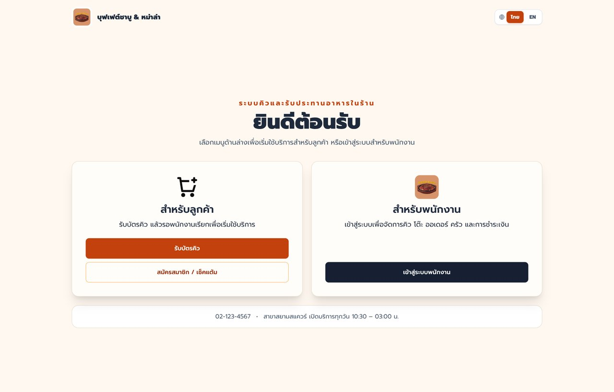
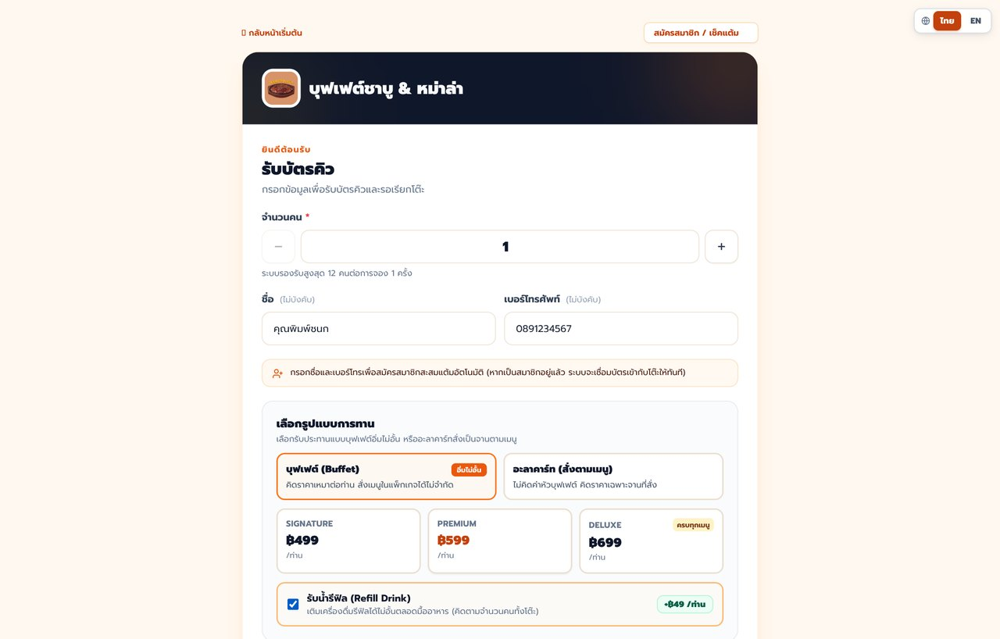
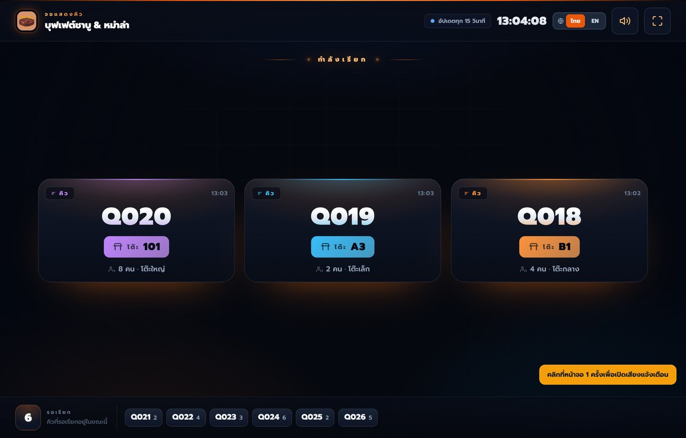
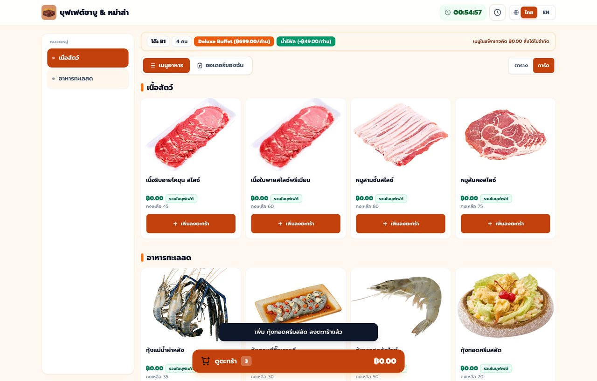
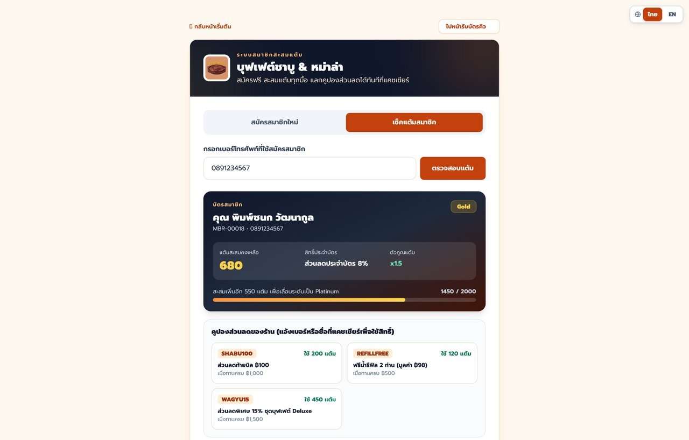
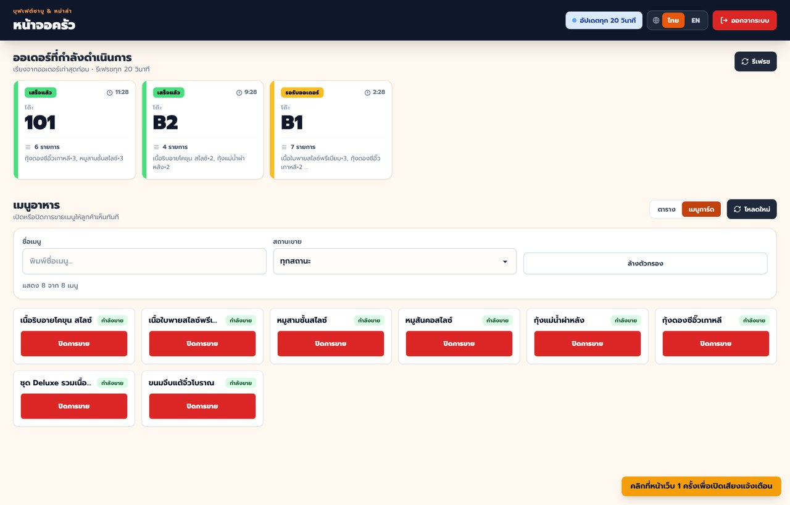
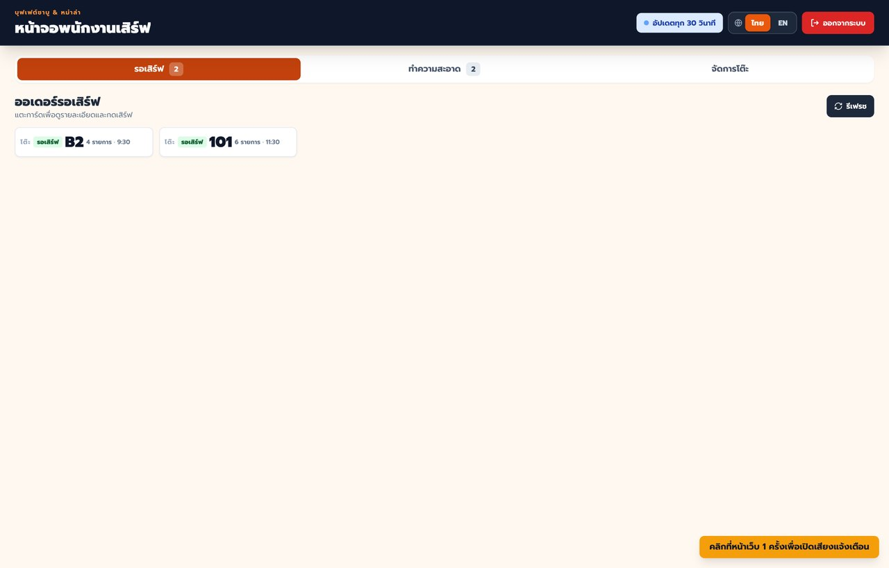
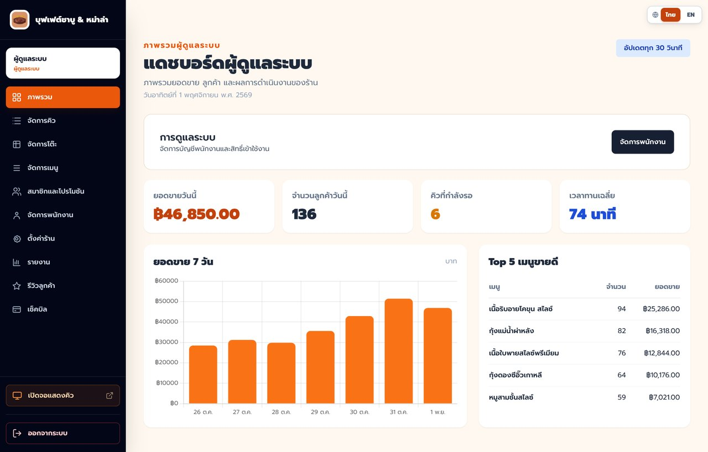
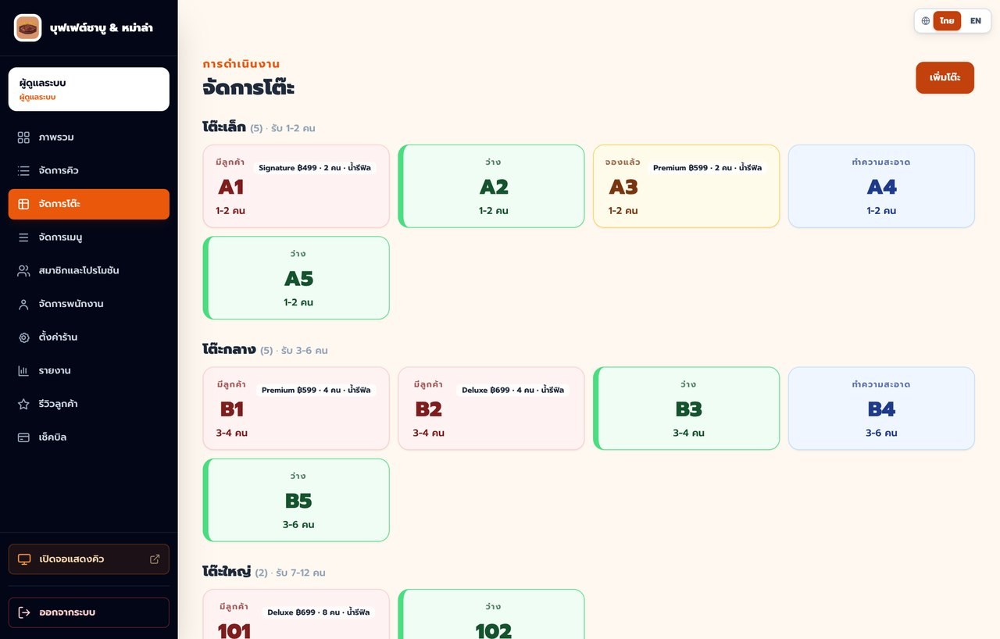
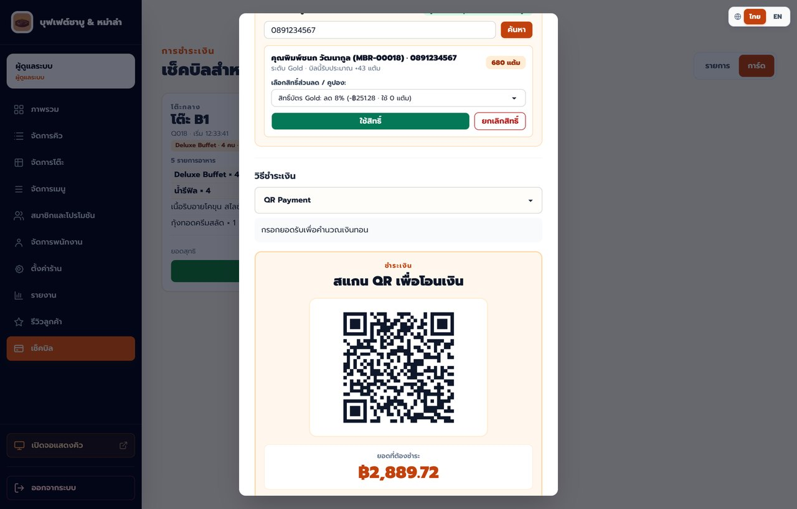

  
  <h1>ระบบจัดการร้านบุฟเฟต์ชาบู & หม่าล่าครบวงจร</h1>
  
เว็บแอปพลิเคชันสำหรับบริหารจัดการหน้าร้านและหลังร้านแบบครบวงจร ตั้งแต่การรับบัตรคิว จอเรียกคิว สั่งอาหารผ่าน QR ประจำโต๊ะ ระบบครัว พนักงานเสิร์ฟ สมาชิกสะสมแต้ม ไปจนถึงคิดเงินและดูรายงานยอดขาย

  
<strong>Make by Zentrary</strong>

---

## บัญชีสำหรับทดสอบ

เว็บที่เปิดให้ทดสอบ: [https://websitebuffet.vercel.app](https://websitebuffet.vercel.app)

หน้าลูกค้าไม่ต้องเข้าสู่ระบบ ใช้รับคิว สั่งอาหาร ดูสมาชิก และให้คะแนนได้เลย  
หน้าพนักงานเข้าสู่ระบบที่ [https://websitebuffet.vercel.app/login.html](https://websitebuffet.vercel.app/login.html)

บัญชีทดสอบใช้รหัสผ่านเดียวกันทั้งหมด

| บทบาท | Username | Password | หลังเข้าสู่ระบบ |
| --- | --- | --- | --- |
| ผู้ดูแลระบบ | `admin` | `Demo@12345` | แดชบอร์ด จัดการร้าน พนักงาน และตั้งค่าร้าน |
| ผู้จัดการ | `manager` | `Demo@12345` | แดชบอร์ด คิว โต๊ะ เมนู สมาชิก รายงาน และแคชเชียร์ |
| พนักงานครัว | `kitchen` | `Demo@12345` | หน้าจอครัว |
| พนักงานบริการ | `waiter` | `Demo@12345` | หน้าจอพนักงานเสิร์ฟ |

---

## เว็บไซต์นี้ทำอะไรได้บ้าง

เว็บไซต์นี้ออกแบบมาเพื่อรองรับการทำงานจริงของร้านอาหารทั้งรูปแบบ **บุฟเฟต์ (Buffet)** และ **อะลาคาร์ทสั่งตามเมนู (À la carte)** ภายในเว็บเดียว โดยเชื่อมการทำงานของทุกฝ่ายเข้าด้วยกันแบบเรียลไทม์:

- **ฝั่งลูกค้า** — กดรับบัตรคิวล่วงหน้า เลือกรูปแบบการทานและแพ็กเกจบุฟเฟต์ ผูกเบอร์สะสมแต้มสมาชิก สแกน QR Code ประจำโต๊ะเพื่อสั่งอาหารผ่านมือถือ เช็คสถานะอาหารและเวลาทานคงเหลือ เช็คแต้มและคูปองส่วนลด รวมถึงให้คะแนนรีวิวหลังใช้บริการ
- **ฝั่งหน้าร้านและบริการ** — แสดงลำดับคิวที่กำลังเรียกบนหน้าจอทีวีหน้าร้าน ส่งรายการอาหารเข้าหน้าจอครัวทันทีเมื่อลูกค้ากดสั่ง แจ้งเตือนพนักงานเสิร์ฟเมื่ออาหารพร้อมเสิร์ฟหรือมีโต๊ะรอทำความสะอาด
- **ฝั่งแคชเชียร์และผู้ดูแลร้าน** — เปิดโต๊ะรับลูกค้าทั้งจากคิวและลูกค้าหน้าร้าน (Walk-in) พิมพ์สลิปความร้อนขนาด 80 มม. คิดเงินค่าบุฟเฟต์ น้ำรีฟิล และเมนูสั่งเพิ่ม คำนวณส่วนลดสมาชิก รับชำระทั้งเงินสดและสแกนจ่าย QR พร้อมเพย์ พร้อมจัดการเมนู โต๊ะ พนักงาน ตั้งค่าร้าน และดูรายงานยอดขายครบจบในที่เดียว
- **รองรับ 2 ภาษา** — สลับภาษา **ไทย / English** ได้ทันทีทุกหน้าทั้งฝั่งลูกค้าและฝั่งพนักงาน

---

## ระบบทั้งหมดภายในเว็บไซต์

| ระบบ                                               | รายละเอียดการทำงานหลัก                                                                                                              |
| -------------------------------------------------- | ----------------------------------------------------------------------------------------------------------------------------------- |
| **1. ระบบรับบัตรคิวออนไลน์**                       | รับคิวตามจำนวนลูกค้า เลือกรูปแบบบุฟเฟต์ / อะลาคาร์ท / น้ำรีฟิล ผูกเบอร์สมาชิกอัตโนมัติ และติดตามคิวแบบเรียลไทม์                     |
| **2. ระบบจอแสดงคิวหน้าร้าน**                       | หน้าจอสำหรับเปิดขึ้นจอทีวีหน้าร้าน แสดงหมายเลขคิวที่กำลังเรียก หมายเลขโต๊ะ โซนที่นั่ง และคิวที่รออยู่พร้อมเสียงเรียกเตือน           |
| **3. ระบบสั่งอาหารประจำโต๊ะ (QR Ordering)**        | สแกน QR ประจำโต๊ะเพื่อสั่งอาหาร แยกหมวดหมู่ชัดเจน รองรับเมนูรวมในบุฟเฟต์ (`฿0`) และเมนูสั่งเพิ่มพิเศษ พร้อมตัวนับเวลาทานคงเหลือ     |
| **4. ระบบสมาชิกและสะสมแต้ม**                       | สมัครสมาชิกฟรี สะสมแต้มจากยอดใช้จ่าย เลื่อนระดับบัตร (Bronze / Silver / Gold / Platinum) และแลกใช้ส่วนลดหรือคูปองโปรโมชัน           |
| **5. ระบบจอครัว (Kitchen Display System)**         | รับออเดอร์เข้าครัวแบบเรียลไทม์พร้อมเสียงเตือน อัปเดตสถานะการปรุงอาหาร และเปิด/ปิดเมนูที่วัตถุดิบหมดได้ทันที                         |
| **6. ระบบพนักงานบริการ (Waiter System)**           | แจ้งเตือนรายการอาหารที่ครัวทำเสร็จพร้อมเสิร์ฟไปตามโต๊ะ กดยืนยันเสิร์ฟ และจัดการเคลียร์โต๊ะที่รอทำความสะอาด                          |
| **7. ระบบคิดเงินและชำระเงิน (Cashier & Checkout)** | คำนวณยอดบุฟเฟต์ น้ำรีฟิล เมนูเพิ่มเติม ส่วนลดสมาชิก รับชำระเงินสดและสร้าง QR พร้อมเพย์ระบุยอดเงินอัตโนมัติ พร้อมพิมพ์ใบเสร็จ 80 มม. |
| **8. ระบบประเมินความพึงพอใจและรีวิว**              | ลูกค้าให้คะแนนความประทับใจ 1–5 ดาวและเขียนข้อเสนอแนะหลังทานเสร็จ พร้อมหน้าสรุปผลรีวิวสำหรับผู้ดูแลร้าน                              |
| **9. ระบบผู้ดูแลร้านและรายงานสถิติ**               | แดชบอร์ดสรุปยอดขายรายวัน กราฟยอดขาย 7 วัน เมนูขายดี จัดการโต๊ะ เมนู สต็อก สมาชิก พนักงาน ตั้งค่าร้าน และส่งออกรายงาน Excel          |

---

## การใช้งานเว็บและฟังก์ชันในแต่ละส่วน

### 1. การใช้งานฝั่งลูกค้า (Customer)

#### การรับบัตรคิวและเลือกรูปแบบการทาน

- ระบุจำนวนผู้ใช้บริการ (รองรับ 1–12 ท่านต่อคิว) โดยระบบจัดโซนโต๊ะที่เหมาะสมให้อัตโนมัติ
- เลือกรูปแบบการรับประทานได้ทั้ง **บุฟเฟต์ (Signature / Premium / Deluxe)** หรือ **อะลาคาร์ท (สั่งตามเมนู)** พร้อมตัวเลือกเพิ่ม **น้ำรีฟิล (Refill Drink)**
- กรอกชื่อและเบอร์โทรศัพท์เพื่อสมัครสมาชิกใหม่หรือเชื่อมบัตรสมาชิกเข้ากับโต๊ะรับแต้มสะสมอัตโนมัติ
- ตรวจสอบจำนวนคิวก่อนหน้า เวลารอโดยประมาณ กดยืนยันเมื่อถูกเรียกคิว ยกเลิกคิว หรือกู้คืนบัตรคิวเดิมได้

#### หน้าจอแสดงคิวหน้าร้าน

- แสดงการ์ดหมายเลขคิวที่กำลังเรียกขนาดใหญ่ เห็นชัดเจนจากระยะไกล พร้อมระบุหมายเลขโต๊ะ จำนวนคน และโซนที่นั่ง
- แสดงรายการคิวที่กำลังรออยู่ทั้งหมดด้านล่างหน้าจอ พร้อมตัวนับจำนวนคิวรอแบบเรียลไทม์
- รองรับการเปิดโหมดเต็มหน้าจอ (Fullscreen) และเปิด/ปิดเสียงแจ้งเตือนเมื่อมีการเรียกคิวใหม่

#### การสั่งอาหารประจำโต๊ะและเช็คสถานะ

- สแกน QR Code ประจำโต๊ะเพื่อเข้าสู่หน้าเมนูของโต๊ะตัวเองทันทีโดยไม่ต้องล็อกอิน
- แสดงป้ายแพ็กเกจบุฟเฟต์ของโต๊ะและเวลานั่งทานคงเหลือแบบนับถอยหลังด้านบนหน้าจอ
- เมนูที่อยู่ในแพ็กเกจบุฟเฟต์จะแสดงราคา **`฿0.00 รวมในบุฟเฟต์`** อัตโนมัติ ส่วนเมนูที่อยู่นอกแพ็กเกจหรือโหมดอะลาคาร์ทจะแสดงราคาตามจริง
- เลือกดูตามหมวดหมู่ ค้นหาชื่อเมนู สลับมุมมองแบบการ์ดหรือรายการ เพิ่มรายการลงตะกร้า ระบุหมายเหตุถึงครัว (เช่น ไม่เผ็ด / ขอพริกเพิ่ม) และกดส่งออเดอร์เข้าครัวได้ทันที
- ดูรายการออเดอร์ที่สั่งไปแล้วและติดตามสถานะอาหารแต่ละรอบ (`รอรับออเดอร์` → `กำลังปรุง` → `พร้อมเสิร์ฟ` → `เสิร์ฟแล้ว`) รวมถึงกดเรียกเช็คบิลผ่านหน้าเว็บได้

#### ระบบสมาชิก สะสมแต้ม และเช็คสิทธิพิเศษ

- สมัครสมาชิกใหม่ผ่านหน้าเว็บได้ฟรีด้วยชื่อและเบอร์โทรศัพท์
- กรอกเบอร์โทรศัพท์เพื่อตรวจสอบระดับบัตรสมาชิก คะแนนสะสมคงเหลือ สิทธิ์ส่วนลดประจำบัตร ความคืบหน้าในการเลื่อนระดับถัดไป และรายการคูปองส่วนลดที่สามารถนำไปใช้ที่แคชเชียร์ได้

---

### 2. การใช้งานฝั่งครัวและพนักงานหน้าร้าน (Kitchen & Waiter)

#### หน้าจอครัว (Kitchen Display System)

- แสดงการ์ดออเดอร์ที่ลูกค้าสั่งเข้ามาเรียงตามลำดับเวลาก่อน–หลัง พร้อมเวลาที่รอนับจากตอนสั่งและเสียงแจ้งเตือนเมื่อมีออเดอร์ใหม่
- กดดูรายละเอียดรายการอาหาร จำนวน และหมายเหตุพิเศษของแต่ละโต๊ะ พร้อมเปลี่ยนสถานะเป็น **กำลังปรุง** หรือ **เสร็จพร้อมเสิร์ฟ**
- มีส่วนจัดการเมนูอาหารสำหรับครัวโดยเฉพาะ สามารถค้นหาและกด **เปิด/ปิดการขายเมนู** ได้ทันทีเมื่อวัตถุดิบหมด หน้าเมนูของลูกค้าจะอัปเดตตามทันที

#### หน้าจอพนักงานบริการ (Waiter)

- **แท็บรอเสิร์ฟ** — แสดงรายการอาหารที่ครัวปรุงเสร็จแล้วพร้อมหมายเลขโต๊ะและจำนวนรายการ กดยืนยันเมื่อนำไปเสิร์ฟถึงโต๊ะลูกค้าเรียบร้อย
- **แท็บทำความสะอาด** — แสดงโต๊ะที่ลูกค้าเช็คบิลออกแล้วเพื่อให้พนักงานเข้าเก็บและทำความสะอาด ก่อนกดเปลี่ยนสถานะโต๊ะกลับเป็นว่างพร้อมรับลูกค้ารายถัดไป
- **แท็บจัดการโต๊ะ** — ดูภาพรวมสถานะโต๊ะทุกโซนแบบเรียลไทม์จากมือถือหรือแท็บเล็ตของพนักงาน

---

### 3. การใช้งานฝั่งผู้ดูแลร้าน ผู้จัดการ และแคชเชียร์ (Admin & Backoffice)

#### แดชบอร์ดภาพรวมร้านและรายงานสถิติ

- แสดงภาพรวมผลประกอบการประจำวันทำการแบบเรียลไทม์ ได้แก่ **ยอดขายวันนี้ จำนวนลูกค้าวันนี้ คิวที่กำลังรอ และเวลานั่งทานเฉลี่ย**
- แสดงกราฟเปรียบเทียบยอดขายย้อนหลัง 7 วัน และตาราง **Top 5 เมนูขายดี**
- ระบบรายงานแบบละเอียดสามารถเลือกดูตามช่วงวันที่ ดูสถิติคิว ออเดอร์ ยอดขายแยกตามวิธีชำระเงิน และส่งออกข้อมูลเป็นไฟล์ **Excel (`.xlsx`)** ได้

#### การจัดการคิวและจัดการโต๊ะอาหาร

- **จัดการคิวหน้าร้าน** — ออกบัตรคิวให้ลูกค้า กดเรียกคิวพร้อมเลือกโต๊ะว่างที่ตรงกับจำนวนคน กดรับลูกค้าเข้าโต๊ะ ข้ามคิว/ไม่มาตามนัด พิมพ์บัตรคิวขนาดสลิป 80 มม. และกดจบรายการคิว
- **จัดการโต๊ะอาหาร** — แบ่งผังโต๊ะตามโซน (`โต๊ะเล็ก 1–2 คน`, `โต๊ะกลาง 3–6 คน`, `โต๊ะใหญ่ 7–12 คน`) แยกสีตามสถานะ (`ว่าง`, `จองแล้ว`, `มีลูกค้า`, `ทำความสะอาด`)
- **เปิดโต๊ะหน้าร้านทันที (Walk-in)** — สำหรับลูกค้าที่เดินเข้าร้านตอนโต๊ะว่าง พนักงานสามารถคลิกที่โต๊ะว่างเพื่อเลือกรูปแบบบุฟเฟต์/อะลาคาร์ท ระบุจำนวนคน เปิดโต๊ะ และพิมพ์ **สลิป QR สั่งอาหารขนาด 80 มม.** ให้ลูกค้าสแกนสั่งอาหารได้ทันที

#### การคิดเงิน ชำระเงิน และส่วนลดสมาชิก (Cashier Checkout)

- รวมรายการค่าใช้จ่ายของโต๊ะให้อัตโนมัติ ทั้งค่าหัวแพ็กเกจบุฟเฟต์ ค่าน้ำรีฟิล รายการอาหารที่สั่งเพิ่ม ค่าบริการ (Service Charge) และภาษีมูลค่าเพิ่ม (VAT)
- ค้นหาสมาชิกด้วย **ชื่อ เบอร์โทรศัพท์ หรือรหัสสมาชิก** (หรือสมัครสมาชิกด่วนหน้าเคาน์เตอร์) เพื่อเลือกใช้สิทธิ์ส่วนลดประจำระดับบัตรหรือแลกแต้มใช้คูปองส่วนลด พร้อมคำนวณแต้มสะสมที่ได้รับจากบิลให้อัตโนมัติ
- รองรับการชำระเงิน 2 ช่องทาง:
  - **เงินสด (Cash)** — กรอกยอดเงินที่รับมา ระบบคำนวณเงินทอนให้อัตโนมัติ
  - **สแกน QR พร้อมเพย์ (PromptPay QR)** — สร้าง QR Code พร้อมเพย์ที่ระบุยอดเงินสุทธิของบิลให้อัตโนมัติ เพื่อให้ลูกค้าสแกนโอนและพนักงานตรวจสอบสลิปก่อนกดยืนยันรับชำระ
- รองรับการพิมพ์ **ใบเสร็จรับเงินขนาดกระดาษความร้อน 80 มม.** พอดีหน้ากระดาษสลิป

#### ระบบบริหารจัดการร้านอื่น ๆ ในหลังบ้าน

- **จัดการเมนูอาหารและสต็อก** — เพิ่ม แก้ไข ลบเมนู อัปโหลดรูปภาพ กำหนดหมวดหมู่ ตั้งระดับแพ็กเกจบุฟเฟต์ที่สั่งได้ กำหนดจำนวนสต็อกคงเหลือ และตั้งจุดแจ้งเตือนเมื่อวัตถุดิบใกล้หมด
- **จัดการสมาชิกและโปรโมชัน** — ดูรายชื่อสมาชิกทั้งหมด ค้นหาและกรองตามระดับบัตรทันที ปรับเพิ่ม/ลดคะแนนสะสม และสร้าง/แก้ไขคูปองส่วนลด
- **ดูรีวิวและความคิดเห็นลูกค้า** — ดูคะแนนเฉลี่ยร้าน อัตราความพึงพอใจ และอ่านข้อเสนอแนะจากลูกค้าแยกตามระดับดาว
- **จัดการพนักงาน** — เพิ่มบัญชีพนักงาน กำหนดบทบาทหน้าที่ (`ผู้ดูแลระบบ`, `ผู้จัดการ`, `พนักงานครัว`, `พนักงานบริการ`) และเปิด/ปิดสิทธิ์การเข้าใช้งานได้ทันที
- **ตั้งค่าร้านค้า** — ปรับแต่งชื่อร้าน โลโก้ แบนเนอร์ ข้อความต้อนรับ เบอร์ติดต่อ เวลาเปิด–ปิดร้าน เวลาปิดรับคิว ระยะเวลานั่งทาน ราคาบุฟเฟต์แต่ละแพ็กเกจ ราคาน้ำรีฟิล รูปแบบคิด VAT / Service Charge และเลขพร้อมเพย์รับเงินของร้าน

---

  
<strong>Make by Zentrary</strong>

